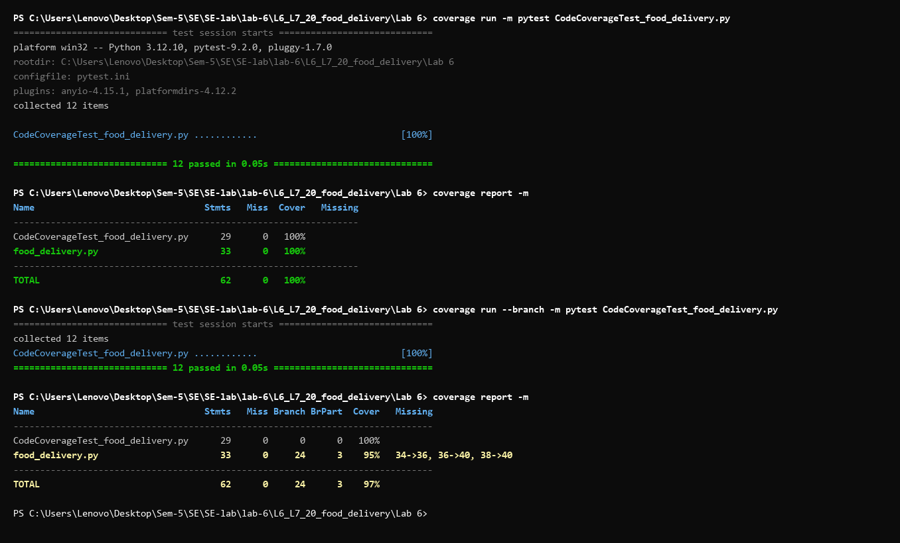
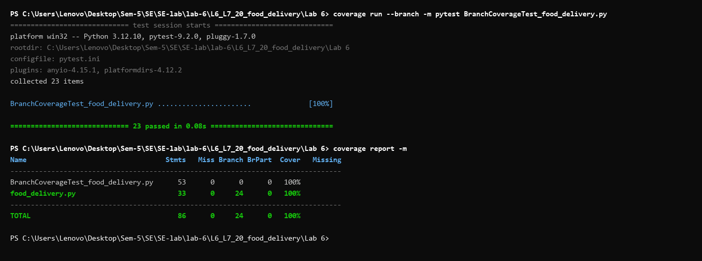

# Lab 6: Code and Branch Coverage Analysis

**Repository:** `L6_L7_20_food_delivery`  
**Application Module:** [`food_delivery.py`](food_delivery.py)  

---

## 1. Overview & Objectives

- **Code Coverage (Line / Statement Coverage):** Measures the percentage of code lines executed during testing. Line coverage answers: *"Did execution pass through this line of code at least once?"*
- **Branch Coverage:** Measures the percentage of decision outcomes (e.g., each `if`, `elif`, `else` branch evaluating to both `True` and `False`) exercised during testing. Branch coverage answers: *"Did every control structure evaluate to both True and False?"*
- **Why Branch Coverage Matters:** 100% line coverage does not guarantee thorough testing. In `estimated_time()`, running with `is_peak_hour=True` and `restaurant_busy=True` executes every line, giving 100% statement coverage, but completely misses what happens when `is_peak_hour=False` or `restaurant_busy=False`. Branch coverage catches untested execution paths and latent defects.

---

## 2. Module Under Test: `food_delivery.py`

The application consists of three functions:
1. `delivery_charge(distance_km, order_value, is_raining)`:
   - Validates distance ($0 < \text{distance} \le 15$ km), raises `ValueError` if out of bounds.
   - Free delivery (`charge = 0`) if $\text{order\_value} \ge 500$.
   - Distance tiers: $\le 3$ km (\$20), $\le 8$ km (\$40), $> 8$ km (\$60).
   - Rain surcharge: adds \$30 if `is_raining` is `True`.
2. `apply_coupon(order_value, code, is_first_order)`:
   - Returns unchanged order value if `code is None`.
   - Validates coupon exists in `COUPONS` (`"SAVE50"`: 50, `"WELCOME"`: 100), otherwise raises `ValueError`.
   - Validates `"WELCOME"` coupon is only usable when `is_first_order == True`.
   - Requires $\text{order\_value} \ge 200$ to apply discounts; returns original value if below minimum.
3. `estimated_time(distance_km, is_peak_hour, restaurant_busy)`:
   - Base time: $15 + 4 \times \text{distance\_km}$ minutes.
   - Peak hour adjustment: $+10$ minutes if `is_peak_hour`.
   - Busy restaurant adjustment: $+15$ minutes if `restaurant_busy`, plus an additional $+5$ minutes if both `restaurant_busy` and `is_peak_hour` are `True`.

---

## 3. Coverage Analysis Summary

| Stage | Test File | Line Coverage | Branch Coverage | Status |
| :--- | :--- | :---: | :---: | :---: |
| **Initial Starter Test** | `test_food_delivery.py` (starter) | **36%** (21 misses) | **30%** (5 partial) | Incomplete |
| **Code Coverage Test** | `CodeCoverageTest_food_delivery.py` | **100%** (0 misses) | **95%** (3 partial branches) | Passed ($\ge 90\%$) |
| **Branch Coverage Test** | `BranchCoverageTest_food_delivery.py` | **100%** (0 misses) | **100%** (24/24 branches) | Passed ($\ge 90\%$) |

---

## 4. Commands to Run & Reproduce

```bash
# 1. Install dependencies
pip install coverage pytest

# 2. Run Code Coverage Suite
coverage run -m pytest CodeCoverageTest_food_delivery.py
coverage report -m

# 3. Run Branch Coverage Suite
coverage run --branch -m pytest BranchCoverageTest_food_delivery.py
coverage report -m

# 4. Run Pytest directly across all suites
pytest
```

---

## 5. Deliverables & Artifacts

- **Code Coverage Test File:** [`CodeCoverageTest_food_delivery.py`](CodeCoverageTest_food_delivery.py) (12 tests, 100% statement coverage)
- **Branch Coverage Test File:** [`BranchCoverageTest_food_delivery.py`](BranchCoverageTest_food_delivery.py) (23 tests, 100% branch coverage)
- **Full Test File:** [`test_food_delivery.py`](test_food_delivery.py)
- **Terminal Output Screenshots:**
  - Code Coverage: [`code_coverage_report.png`](code_coverage_report.png)
  - Branch Coverage: [`branch_coverage_report.png`](branch_coverage_report.png)

### Terminal Output: Code Coverage Analysis


### Terminal Output: Branch Coverage Analysis


---

## 6. Commit History

1. `feat(coverage): achieve 100% line coverage and add code coverage analysis report`  
   - Added `CodeCoverageTest_food_delivery.py` (12 tests achieving 100% statement coverage)
   - Added `code_coverage_report.png`
2. `feat(branch-coverage): achieve 100% branch coverage and add branch analysis report`  
   - Added `BranchCoverageTest_food_delivery.py` (23 tests achieving 100% branch coverage)
   - Added `branch_coverage_report.png`
   - Updated `test_food_delivery.py` and `README.md`
